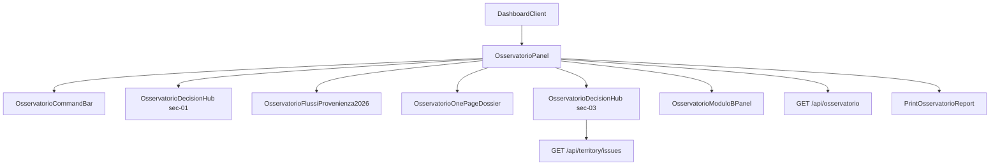

# Osservatorio FN v3.2 — Funzionamento completo

Documento tecnico per sviluppatori (ottobre 2026). Descrive architettura, flussi dati, moduli A/B/C, API, motori di analisi e componenti UI del tab **Osservatorio** (`/app/osservatorio`).

---

## 1. Ruolo nel prodotto

L’**Osservatorio integrato** unisce tre fili metodologici (da *Osservatorio.docx*, 20-10-2026):

| Modulo | Contenuto | Dove vive in codice |
|--------|-----------|---------------------|
| **A · Elettorale** | Consenso regionale, Modulo A (`f,v,s,m,p,q,w`), scenario Monte Carlo | Scenario condiviso da `DashboardClient` → `OsservatorioPanel` |
| **B · Fabbisogni** | Indicatori ISTAT/BesT/AGENAS, stress territoriale | `data/fabbisogni_catalog.json`, `OsservatorioModuloBPanel`, sezione 02 dossier |
| **C · Eventi & opinioni** | Registro episodi, Google Trends, priorità dichiarate | Cloud payload + `osservatorio_events.json`, drawer dati, Modulo C nel dossier |

Periodo operativo UI: **ottobre 2026 → maggio 2027** (previsioni crescita, piano governance).

---

## 2. Ingresso applicativo

### Routing

```typescript
// platform/src/lib/appRoutes.ts
export type AppTab = "scenario" | "osservatorio" | "locali";

export const APP_TAB_PATHS = {
  scenario: "/app/scenario",
  osservatorio: "/app/osservatorio",
  locali: "/app/locali",
} as const;
```

### Montaggio nel dashboard

Il tab Osservatorio **non ricalcola da solo** lo scenario: riceve lo stesso `ScenarioResult` prodotto da `/api/scenario` nel tab Scenario (stato `S`, pesi, flussi, poll regionale).

```typescript
// platform/src/components/DashboardClient.tsx (estratti)
const regionalGrowthByRegion = useMemo(
  () =>
    buildRegionalGrowthMap(
      scenarioToRegionalGrowthInputs(scenario, poll),
      S,
      growthRegime,
      flussiMatrixId,
    ),
  [scenario, poll, S, growthRegime, flussiMatrixId],
);

{tab === "osservatorio" && (
  <OsservatorioPanel
    scenario={scenario}
    baselineScenario={baselineScenario}
    liveS={S}
    flussiIpsos={flussiIpsos}
    flussiMatrixId={flussiMatrixId}
    onSelectFlussiMatrix={applyFlussiMatrix}
    regionalGrowthByRegion={regionalGrowthByRegion}
    onRestoreBaselineS={() => setS(OFFICIAL_S)}
    onOpenTab={navigateTab}
  />
)}
```

**Implicazione:** cambiare `S` o i flussi nel tab Scenario aggiorna immediatamente termometro regionale, previsioni Mag ’27 e simulatore conversione nell’Osservatorio.

---

## 3. Architettura UI (composizione)



### Ordine di render in `OsservatorioPanel`

```tsx
// platform/src/components/OsservatorioPanel.tsx (struttura return)
<>
  <OsservatorioCommandBar ... />
  <OsservatorioDecisionHub section="01" ... />   {/* Forza / campagna */}
  <OsservatorioFlussiProvenienza2026 ... />       {/* Matrici flussi 2026 */}
  <OsservatorioOnePageDossier operationalTailOnly hideSchedaAndModuloC ... />
  <OsservatorioDecisionHub section="03" ... />   {/* Radar + simulatore */}
  <OsservatorioModuloBPanel ... />
  <PrintOsservatorioReport ... />                 {/* nascosto, stampa PDF */}
</>
```

| Sezione DOM | Componente | Funzione |
|-------------|------------|----------|
| `#osservatorio-sec-01` | `OsservatorioDecisionHub` | Termometro 20 regioni, mappe alta/bassa conversione, Mag ’27 |
| *(inline)* | `OsservatorioFlussiProvenienza2026` | Ipsos luglio vs Sky TG24 ottobre |
| `#osservatorio-sec-02` | dentro `OnePageDossier` | Radiografia + scheda mensile Modulo A |
| `#osservatorio-sec-03` | `OsservatorioDecisionHub` | Radar problemi + Promesse FN × conversione |
| `#osservatorio-sec-04` | `OsservatorioModuloBPanel` | Indicatori fabbisogni per regione |
| `#osservatorio-sec-05` | `OnePageDossier` (se nav full) | Modulo C, Trends, piano ’27 |

La **command bar** usa navigazione `compact` (salta ancora 02 e 05 negli anchor sticky; il dossier espone comunque la 02 con `operationalTailOnly`).

---

## 4. Stato territorio condiviso

Due stati sincronizzati in `OsservatorioPanel`:

- `mainTerritory`: `"NAZIONALE"` | `Region` — scope analitico globale
- `regione`: `Region` — es. `"Lazio"` per scheda PDF e Modulo B

```typescript
// platform/src/lib/engine/osservatorioTerritoryScope.ts
export type TerritoryScope = "NAZIONALE" | Region;
export const TERRITORY_NAZIONALE = "NAZIONALE" as const;

export function isRegionScope(scope: TerritoryScope): scope is Region {
  return scope !== TERRITORY_NAZIONALE;
}
```

Selezionare una card regione in sezione 01 imposta `mainTerritory` + `regione`; il radar (03) e il simulatore usano `selectedScope` derivato da `mainTerritory`.

---

## 5. Caricamento dati e persistenza

### Bootstrap al mount

```typescript
// OsservatorioPanel — useEffect
useEffect(() => {
  void fetch("/api/osservatorio")
    .then((r) => r.json())
    .then((data) => {
      if (data.fabbisogni) setFabbisogni(data.fabbisogni);
      const local = loadOsservatorioLocal();
      const merged = mergeCloud(data.cloud ?? emptyCloud(), local);
      setCloud(merged);
      // ...
    });
}, [mergeCloud]);
```

### Payload cloud (Modulo C + operatività)

```typescript
// platform/src/lib/engine/osservatorioTypes.ts
export interface OsservatorioCloudPayload {
  events: OsservatorioEvento[];
  trendsSeries: GoogleTrendsSeries[];
  prioritaDichiarate: Partial<Record<Region, PrioritaDichiarateRilevazione>>;
  monthlyNotes: Partial<Record<Region, string>>;
}
```

**Merge policy:** server (DB o seed JSON) + overlay `localStorage` (`fn_v32_osservatorio_cloud`). Eventi draft creati in UI restano locali finché non si fa **Salva cloud** (`POST /api/osservatorio`).

### API GET/POST

```typescript
// platform/src/app/api/osservatorio/route.ts (GET — semplificato)
export async function GET() {
  const session = await requireSession();
  if (!session) return unauthorizedResponse();

  const fabbisogni = loadJson<FabbisogniCatalogFile>("fabbisogni_catalog.json");
  const fromDb = await loadOsservatorioFromDb();
  if (fromDb) {
    return Response.json({ fabbisogni, cloud: fromDb.payload, dbConnected: true, ... });
  }
  return Response.json({
    fabbisogni,
    cloud: { events: fileEvents.events, trendsSeries: [], ... },
    source: "seed",
  });
}
```

File statici:

- `platform/data/fabbisogni_catalog.json` — Modulo B
- `platform/data/osservatorio_events.json` — eventi seed Modulo C

---

## 6. Sezione 01 — Termometro e strategia campagna

**Componente:** `OsservatorioDecisionHub` (`section="01"`).

### Indice di forza territoriale

```typescript
// platform/src/lib/engine/regionalPartyStrength.ts
export function computeIndiceForzaTerritoriale(row: ScenarioRow, righe: ScenarioRow[]): number {
  const sorted = [...righe].sort((a, b) => b.stima - a.stima);
  const rank = sorted.findIndex((r) => r.regione === row.regione);
  const rankComponent = n <= 1 ? 1 : 1 - rank / (n - 1);
  return Math.round((0.2 + 0.8 * rankComponent) * 100) / 100;
}

export function strengthBandFromIndex(indice: number): StrengthBand {
  if (indice >= 0.7) return "FORTE";
  if (indice >= 0.45) return "MEDIO";
  return "DEBOLE";
}
```

Le 20 card mostrano: indice 0–1, stima %, voti, fascia **FORTE/MEDIO/DEBOLE**, riga **Mag ’27** da `regionalGrowthByRegion`.

### Motore conversione elettorale (storico partiti × promesse FN)

```typescript
// platform/src/lib/fnProgramAndAffinityEngine.ts (concetti)
export const REGIONAL_PARTY_HISTORY: Record<Region, RegionalPartyHistory>;
export const FN_PROMISES_CATALOG: FnPromise[]; // PROM.01 … PROM.08

export function computeIssueConversionGain(
  region: Region,
  category: TerritoryIssueCategory,
  impattoScore: number,
  validVotesRegion: number,
): IssueConversionGain;

export function buildCampaignPriorityLists(scenarioRows): {
  altaConversione: CampaignPriorityRow[];
  bassaConversione: CampaignPriorityRow[];
};
```

UI: due colonne **alta conversione** (permeabilità ≥ 75, bacino Lega/FdI) vs **bassa conversione** (muro PD/CSX).

### Previsione crescita Ott ’26 → Mag ’27

Calcolata in `DashboardClient` con `buildRegionalGrowthMap` (`politicalModel.ts`), passata come prop — non ricalcolata dentro l’Osservatorio.

---

## 7. Flussi provenienza voti 2026

**Componente:** `OsservatorioFlussiProvenienza2026`.

Matrici ufficiali in `politicalModel.ts`:

- `ipsos_luglio_2026` — FdI 31%, Lega 25%, astenuti 36%
- `skytg24_ottobre_2026` — FdI 19,5%, Lega 13,8%, astenuti 57,4%

Selezione matrice: `onSelectFlussiMatrix` → `DashboardClient.applyFlussiMatrix` → ricalcolo scenario + growth map.

---

## 8. Sezione 02 — Radiografia e scheda mensile

**Componente:** `OsservatorioOnePageDossier` con flag `operationalTailOnly` e `hideSchedaAndModuloC`.

Per scope regionale include:

- KPI consenso da `scenario.righe`
- **Barra storico elettorale** (Europee 2024) via `RegionalPartyHistoryBar` + `getRegionalPartyHistory`
- Tabella dimensioni §8 documento (`osservatorioSchedaDisplay.ts`)

Scheda mensile sintetica:

```typescript
// platform/src/lib/engine/monthlyScheda.ts
export function buildMonthlyScheda(
  regione: Region,
  scenario: ScenarioResult,
  fabbisogni: FabbisogniRegione | undefined,
  events: OsservatorioEvento[],
  trendsNote: string,
  prioritaRilevazione?: PrioritaDichiarateRilevazione,
  monthlyNote?: string,
): SchedaMensileRiga[];
```

Usata da `PrintOsservatorioReport` / export PDF.

---

## 9. Sezione 03 — Radar problemi e simulatore

### Fetch issue

```typescript
// OsservatorioDecisionHub — loadIssues
const res = await fetch(
  `/api/territory/issues?region=${encodeURIComponent(regionQ)}${catQ}`,
  { cache: "no-store" },
);
```

### Risoluzione lato server

```typescript
// platform/src/lib/engine/territoryIssuesEngine.ts
export async function resolveTerritoryIssues(regionParam, categoryParam) {
  const region = normalizeTerritoryQueryRegion(regionParam);
  const catalog = dedupeIssues(catalogIssuesForRegion(region));
  let live = await fetchLiveIssues(region); // Google News + ANSA RSS
  let merged = dedupeIssues([...catalog, ...live]).sort((a, b) => b.impattoScore - a.impattoScore);
  // filtro categoria, max 12 issue
}
```

Categorie: `SANITA | TRASPORTI | LAVORO | SICUREZZA | COSTO_VITA | TERRITORIO`.

### Arricchimento conversione (client)

```typescript
// territoryIssuesEngine.ts
export function enrichIssuesWithConversion(
  issues: TerritoryIssue[],
  region: Region | "NAZIONALE",
  validVotesRegion: number,
): TerritoryIssue[] {
  return issues.map((issue) => ({
    ...issue,
    conversion: computeIssueConversionGain(...),
  }));
}
```

Ogni scheda problema espone 4 blocchi: problema/Modulo B, promessa FN, storico/permeabilità, **+pp / +voti** e pulsante **Simula intervento** (max 3 temi; `simulateSelectedIssuesGain`).

### Da radar a Modulo C

```typescript
// OsservatorioPanel — registerIssueAsEvent
const nuovo: OsservatorioEvento = {
  id: crypto.randomUUID(),
  titolo: issue.titoloProblema,
  tema: categoryLabel(issue.categoria),
  fontePrimaria: issue.sourceUrl,
  regione: targetRegion,
  statoVerifica: "draft",
  // finestra event study ±14 gg
};
persistCloud({ ...cloud, events: [nuovo, ...events] });
```

---

## 10. Modulo B dedicato

**Componente:** `OsservatorioModuloBPanel` — navigazione regioni, tabella indicatori con 8 metadati obbligatori (`MetadatiDato`), link a stress domain da `osservatorioTerritoryScope.ts` / fallback catalogo.

---

## 11. Drawer dati, Trends, priorità

Nel dossier (`OnePageDossier`), drawer controllato da `dataDrawerOpen`:

- Import CSV **Google Trends** → `parseGoogleTrendsCsv` → `cloud.trendsSeries`
- Import / form **priorità dichiarate** per regione
- Aggiunta evento draft, note mensili per regione
- Confronto serie Trends: `compareTrendSeries` (`eventStudyProtocol.ts`)

Demo Trends: `buildDemoTrendsSeries()` se nessuna serie attiva.

---

## 12. Export PDF

```typescript
// platform/src/components/PrintOsservatorioReport.tsx
export function exportOsservatorioPdf() {
  window.print(); // stylesheet @media print
}
```

Contenuto: scheda `buildMonthlyScheda`, indicatori fabbisogni, eventi filtrati per regione, serie Trends attiva.

---

## 13. Formattazione e convenzioni UI

- Percentuali/voti italiani: `platform/src/lib/osservatorioFormatIt.ts`, `formatIt.ts`
- Scrollbar sidebar: pattern condiviso con Scenario (`SIDEBAR_SCROLL` dove applicabile)
- Disclaimer metodologici: banner globali + sezione 06 piano ’27 nel dossier full

---

## 14. Dipendenze esterne e limiti

| Dipendenza | Comportamento |
|------------|----------------|
| Sessione auth | `GET/POST /api/osservatorio` richiedono sessione |
| DB opzionale | Se configurato, cloud state su `osservatorio_cloud_state` |
| RSS territory | Timeout ~3,5s; fallback catalogo offline |
| Scenario API | Unica fonte verità per stime regionali e voti |

**Non fare (documentato in UI):**

- Inferire causalità voto ← Google Trends
- Confondere entropia H con consenso
- Trattare fabbisogni oggettivi come proxy elettorali diretti

---

## 15. Estensione — checklist sviluppatore

1. **Nuovo indicatore Modulo B:** aggiornare `fabbisogni_catalog.json` + metadati 8 campi.
2. **Nuova categoria radar:** `territoryIssuesTypes.ts` → keywords in `territoryIssuesEngine.ts` → catalogo in `territoryIssuesCatalog.ts` → promessa in `FN_PROMISES_CATALOG`.
3. **Nuova regione / dato storico:** `REGIONAL_PARTY_HISTORY` in `fnProgramAndAffinityEngine.ts`.
4. **Nuova matrice flussi:** `FLUSSI_MATRICES` in `politicalModel.ts` + UI selector.
5. **Test:** `npm run test` — includere `fnProgramAndAffinityEngine.test.ts`, `territoryIssuesEngine.test.ts`, `regionalPartyStrength.test.ts`.

---

## 16. Riferimenti rapidi file

| Path | Ruolo |
|------|--------|
| `src/components/OsservatorioPanel.tsx` | Root tab, stato cloud, composizione sezioni |
| `src/components/OsservatorioDecisionHub.tsx` | Sezioni 01 e 03 operative |
| `src/components/OsservatorioOnePageDossier.tsx` | Dossier §02–§06, drawer dati |
| `src/components/OsservatorioCommandBar.tsx` | Sticky nav + territorio |
| `src/lib/engine/osservatorioTypes.ts` | Tipi dominio |
| `src/lib/engine/osservatorioTerritoryScope.ts` | Scope, Modulo A, stress nazionale |
| `src/lib/fnProgramAndAffinityEngine.ts` | Storico partiti, promesse, conversione |
| `src/lib/politicalModel.ts` | Flussi 2026, crescita regionale Mag ’27 |
| `src/app/api/osservatorio/route.ts` | API catalogo + cloud |
| `src/app/api/territory/issues/route.ts` | API radar problemi |
| `docs/Osservatorio.md` | Guida metodologica breve (originale) |

---

*Generato per FN v3.2 — allineare questo documento quando si aggiungono sezioni UI o moduli engine.*
