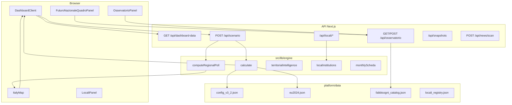

# Recap completo — Piattaforma FN v3.2 (Futuro Nazionale)

Documento di riferimento tecnico e operativo · aggiornato **20 ottobre 2026**.

Stack: **Next.js 16** (App Router), **React**, **TypeScript**, motore deterministico + **Monte Carlo** in `src/lib/engine/`, dati JSON in `platform/data/`, UI in `src/components/`. **65 test Vitest** (`npm run test` in `platform/`).

---

## 1. Architettura a colpo d’occhio



| Layer | Percorso tipico | Ruolo |
|--------|-----------------|--------|
| **Entry** | `src/app/dashboard/page.tsx` | Carica `DashboardClientLoader` |
| **API** | `src/app/api/*` | Sessione, calcolo, osservatorio, locali, snapshot |
| **Engine** | `src/lib/engine/*` | Formula v3.2, MC, poll, istituzioni, intelligence territoriale |
| **UI** | `src/components/*` | Tab, mappa, cruscotto, report PDF |
| **Static geo** | `public/geo/regioni-italia.geojson` | Confini 20 regioni per mappa |

---

## 2. Avvio e bootstrap dati

La dashboard **non** esegue il calcolo completo nel Server Component: il browser richiede il pacchetto iniziale autenticato.

**Pagina:**

```tsx
// src/app/dashboard/page.tsx
import { DashboardClientLoader } from "@/components/DashboardClientLoader";

export default function DashboardPage() {
  return <DashboardClientLoader />;
}
```

**Loader client** → `GET /api/dashboard-data`:

```tsx
// src/components/DashboardClientLoader.tsx (estratto)
const res = await fetch("/api/dashboard-data", { cache: "no-store" });
const data = await res.json(); // { initialScenario, frozenSnapshot, fnConfig }
```

**API bootstrap:**

```ts
// src/app/api/dashboard-data/route.ts
export async function GET() {
  const initialScenario = runDefaultScenario();
  const frozenSnapshot = loadJson<ScenarioResult>("scenario_congelato_18-10-2026.json");
  const fnConfig = loadJson<FnConfig>("config_v3_2.json");
  return Response.json({ initialScenario, frozenSnapshot, fnConfig });
}
```

**Default scenario:**

```ts
// src/lib/engine/loadData.ts
export function runDefaultScenario(nSim?: number): ScenarioResult {
  const cfg = loadJson<FnConfig>("config_v3_2.json");
  const euRaw = loadJson<{ D: Record<Region, EuRegion> }>("eu2024.json");
  return calculate(cfg, euRaw.D, nSim);
}
```

### File dati principali (`platform/data/`)

| File | Contenuto |
|------|-----------|
| `config_v3_2.json` | S nazionale, pesi, iscritti per regione, flussi Ipsos, presenze istituzionali, λ, parametri MC |
| `eu2024.json` | Validi, FdI, Lega 2024 per regione (base EU) |
| `scenario_congelato_18-10-2026.json` | Snapshot ufficiale congelato |
| `fabbisogni_catalog.json` | Modulo B: 4 indicatori × 20 regioni + metadati |
| `osservatorio_events.json` | Seed eventi Modulo C |
| `locali_registry.json` | Registro comuni/cariche FN |
| `locali_events.json` | Eventi locali (revisione) |

---

## 3. Motore elettorale — `calculate`

**Firma:** `calculate(cfg, eu, nSim?, overrides?) → ScenarioResult`  
**File:** `src/lib/engine/calculate.ts`

### 3.1 Override dalla UI

| Override | Effetto |
|----------|---------|
| `S` | Sondaggio nazionale FN |
| `pesi` | Mix flussi / preferenze / iscritti / istituzioni |
| `flussi_ipsos` | Quote FdI, Lega, astensione Ipsos |
| `istituzioniDelta` | Delta presenze da tab Locali o quick dock |

```ts
export function calculate(
  cfg: FnConfig,
  eu: Record<Region, EuRegion>,
  nSim?: number,
  overrides?: CalculateOverrides,
): ScenarioResult {
  const working = structuredClone(cfg);
  if (overrides?.S !== undefined) working.sondaggio_nazionale = overrides.S;
  if (overrides?.pesi !== undefined) working.pesi = normalizePesi(overrides.pesi);
  if (overrides?.flussi_ipsos !== undefined) working.flussi_ipsos = { ...overrides.flussi_ipsos };
  applyIstituzioniDelta(working, overrides?.istituzioniDelta);
  // ...
}
```

### 3.2 Ricostruzione elettorato (2024)

Da **validi EU** regionali e **affluenza %** si ricavano votanti, elettori e astenuti:

```ts
const ratio = REGIONS.reduce((s, r) => s + valid[r], 0) / nazionale.votanti;
for (const r of REGIONS) {
  votanti[r] = valid[r] / ratio;
  elettori[r] = votanti[r] / (aff[r] / 100);
  ast[r] = elettori[r] - votanti[r];
}
```

### 3.3 Preferenze circoscrizione

Per ogni circoscrizione: preferenze **osservate** dove presenti in config, altrimenti **ricostruite** proporzionali a Lega 2024 sul residuo.

### 3.4 Quattro indici normalizzati (per regione)

| Simbolo | Significato | Input principale |
|--------|-------------|----------------|
| **f** | Flussi elettorali | Ipsos × profili FdI/Lega/ast + quota su validi |
| **v** | Preferenze | Circoscrizione |
| **s** | Iscritti FN | `iscritti_regione` |
| **m** | Istituzioni | Presenze × punteggi cariche + λ |

Mix pesato:

```ts
const p = mix(w, f, v, s, m); // w = pesi ufficiali o custom
```

Poi integrazione con **S** e **validi 2024** → **stima %**, **voti_di_scenario**, benchmark, estremi sensibilità pesi.

### 3.5 Monte Carlo

- `nSim` (default da config, UI tipicamente **20.000** dopo debounce).
- Campionamento **Dirichlet** sui pesi + rumore su **S** (`PythonRandom` allineato a Python).
- Output per regione: distribuzione simulata → **lo10 / hi90**, metriche **H** (entropia scenario vs iscritti), KL, JS, matrice stabilità.

### 3.6 `ScenarioRow` (estratto campi UI)

- Elettorale: `stima`, `voti_di_scenario`, `lo10`, `hi90`, `benchmark`
- Organizzazione: `iscritti`, `presenze`, `punti_istituzionali`
- Ricostruzione 2024: `elettori_ricostruiti`, `astenuti_ricostruiti`, `affluenza2024`, `validi2024`
- Decomposizione: `f`, `v`, `s`, `m`, `p`, `w`, `b`

Tipo completo: `src/lib/engine/types.ts` → `ScenarioResult`, `ScenarioRow`.

---

## 4. API scenario e loop client

```ts
// src/app/api/scenario/route.ts (flusso)
const result = calculate(cfg, eu, nSim, overrides);
if (body.includePoll) {
  const poll = computeRegionalPoll(result, pollConfig);
  return Response.json({ scenario: result, poll, pollConfig });
}
return Response.json(result);
```

**Autenticazione:** `requireSession()` — richieste non autenticate → 401.

**DashboardClient — ricalcolo debounced:**

```ts
// src/components/DashboardClient.tsx (estratto)
body: JSON.stringify({
  S,
  pesi,
  nSim,
  includePoll: true,
  pollConfig,
  ...(customFlussi ? { flussi_ipsos: flussiIpsos } : {}),
  ...(hasInstitutional ? { istituzioniDelta: effectiveIstituzioniDelta } : {}),
}),

useEffect(() => {
  fetchScenario(0);           // risposta rapida
  setTimeout(() => fetchScenario(20000), 250); // MC pieno
}, [fetchScenario]);
```

---

## 5. Poll regionale simulato

**File:** `src/lib/engine/regionalPoll.ts`, `regionalPollShared.ts`

Non sostituisce sondaggi reali: deriva dallo **scenario** + regole statistiche.

Per ogni regione (`RegionPollResult`), tra l’altro:

- `piHat`, `moe`, intervallo confidenza
- `classificazione` (TARGET, WATCH, …)
- `contribFlussi`, `contribPreferenze`, `contribIscritti`, `contribIstituzioni`
- `votiStimatiSondaggio`, `votiSoglia`, `margineVotiSoglia`
- `probSuperamentoSoglia` (simulazione gaussiana)

Usato in: `ItalyMap` (tooltip, RNK), `NationalIntelligencePanel`, `RegionPollDrawer`, `RegionalPollTable`, **Quadro FN**.

---

## 6. Tab dashboard — navigazione operatore FN

Definite in `src/components/DashboardClient.tsx` (`NAV` + `tab` state). Shell: `DashboardShell.tsx` (icone Lucide).

| ID tab | Label | Componente | Uso partito |
|--------|-------|------------|-------------|
| `scenario` | Scenario | `AwwwardsLandingHero` / `ItaliaHeroStage` / `ScenarioTerritoryStage` | Mappa, KPI, sensibilità, poll, PDF nota |
| `quadro-fn` | Quadro FN | `FuturoNazionaleQuadroPanel` | Vista 20 regioni integrata (A+B+C organizzativo) |
| `osservatorio` | Osservatorio | `OsservatorioPanel` | Schede mensili, fabbisogni, eventi, Trends |
| `locali` | Locali & News | `LocaliPanel` | Registro, RSS, delta istituzionale |
| `snapshots` | Snapshot & Audit | `SnapshotsAuditPanel` | Congela / diff / audit |
| `storico` | Storico iscritti | `HistoryPanel` | CSV iscrizioni |
| `postvoto` | Post-voto | `PostVotePanel` | vs baseline snapshot |

### Vista Scenario (3 modalità HUD)

`StageTopHud` → `scenarioView`: **landing** | **stage** | **console**  
Default landing cinematico; stage = mappa full-bleed + pannello intelligence; console = layout classico territorio.

### Delta istituzionale

```ts
// merge registry (Locali) + quick dock
effectiveIstituzioniDelta = mergeIstituzioniDeltas(
  applyInstitutional ? registryIstituzioniDelta : undefined,
  quickInstDelta,
);
```

**Engine locali:** `localInstitutions.ts` — `aggregateFnPresences`, `computeIstituzioniDelta` → `CalculateOverrides.istituzioniDelta`.

---

## 7. Mappa Italia (`ItalyMap.tsx`)

### Design performance

- **No** `react-simple-maps`, **no** loop canvas continuo.
- GeoJSON: cache modulo `cachedGeoJson` + fetch una tantum.
- Proiezione: `geoMercator().fitExtent([[70, 38], [730, 690]])`, viewBox **800×730**.
- Pre-calcolo `useMemo`: `pathD`, `capitalXY` per 20 regioni.
- **Un solo `<path>`** per regione; selezione/hover = solo `stroke` (#34D399 / #060A12), riordino DOM.
- Tooltip: `useRef` + `translate3d`; `setHovered` solo on enter/leave path.
- Callout podio **RNK 01–03 + RNK SEL**, leader 45°, clamp anti-collisione.
- Archi leggeri Roma → hub; HUD: CRS, scala km, reset selezione.

### Props principali

`valuesByRegion`, `colorMode` (`stima` | …), `pollByRegion`, `selectedRegion`, `onRegionClick`, `onClearSelection`, `showRegionLabels`, `showCapitals`, `variant: "hero" | "default"`.

Colori stima: gradienti SVG `map-tier-0..4` (`tierIndex` su % stima).

---

## 8. Stage immersivo e intelligence

**`ItaliaHeroStage.tsx`**

- Colonna sinistra moduli 01–04 (KPI animati `useAnimatedNumber`, matrice flussi, legenda).
- Ticker Bloomberg-style.
- `ItalyMap` variant hero + `NationalIntelligencePanel` (radar mix F/P/I/M, rotazione target, istituzioni).

**`NationalIntelligencePanel.tsx`**

- Mix radar SVG (`FLUSSI`, `PREF.`, `ISCR.`, `ISTIT.`).
- Schede cariche, entropy gauge collegata a `metriche.H`.

---

## 9. Osservatorio integrato (Moduli A / B / C)

Guida: `docs/Osservatorio.md`, web `/guida/osservatorio`. Origine metodologica: **Osservatorio.docx**.

| Modulo | Implementazione | Nota metodologica |
|--------|-----------------|-------------------|
| **A Elettorale** | Tab Scenario, calculate, poll | Output modello + MC |
| **B Fabbisogni** | `fabbisogni_catalog.json`, tab Osservatorio | Sanità, lavoro, abitare, entropia — **≠ intenzioni di voto** |
| **C Eventi / opinioni** | Eventi JSON, cloud state, Google Trends CSV | Attenzione mediatica — **≠ causalità automatica** |

**API:** `GET/POST /api/osservatorio` — catalogo + stato cloud (localStorage + opzionale DB `osservatorio_cloud_state`).

**Scheda mensile:** `buildMonthlyScheda()` in `monthlyScheda.ts` — righe per dimensione (scenario, fabbisogni, priorità, eventi, Trends, **impatto sul voto: non stimabile oggi**).

**Event study:** `eventStudyProtocol.ts` — finestre pre/post evento su serie Trends (indice relativo 0–100).

**Import CSV:** `parseGoogleTrendsCsv.ts`, `parsePrioritaSurveyCsv.ts`.

---

## 10. Quadro FN — cruscotto territoriale

**UI:** `FuturoNazionaleQuadroPanel.tsx`  
**Engine:** `territorialIntelligence.ts` (+ test dedicati)

### Cosa mostra

- KPI nazionali: voti scenario, iscritti, astenuti 2024, H, stress medio BesT.
- Tabella **20 regioni** sortabile: stima MC, voti, iscritti, astenuti, fascia mobilitazione, stress Modulo B, stato catalogo, # eventi.
- Scheda regione: Modulo A + contesto organizzativo + 4 indicatori + eventi.
- Azioni: link Osservatorio / Locali / Scenario; **Apri in Scenario** (seleziona regione + view stage).

### Regola d’oro

**Non modifica `calculate`.** Stress e mobilitazione sono `naturaDato: "simulazione"` — pianificazione radicamento/affluenza, non conversione automatica fabbisogni → voti.

```ts
// Esempio: stress da occupazione (valore % → stress invertito)
export function indicatorStressScore(ind: FabbisognoIndicatore): number | null {
  if (key.includes("lavoro")) return clamp(100 - v, 0, 100);
  // sanità, abitare, entropia ...
}
```

---

## 11. Locali & News

| Pezzo | File / route |
|-------|----------------|
| Registro | `data/locali_registry.json`, `GET /api/locali/registry` |
| Delta | `POST /api/locali/compute-delta`, `localInstitutions.ts` |
| News | `newsIngest.ts`, `POST /api/news/scan` (RSS da env) |
| UI | `LocaliPanel`, `NewsReviewPanel`, toggle **Applica al scenario** |

---

## 12. Snapshot, audit, post-voto

- **Freeze** da UI → API snapshots → DB/file.
- **Diff:** `snapshotDiff.ts` — voti, H, delta regionali.
- **Post-voto:** confronto risultati vs baseline snapshot catalogo.
- **Storico iscritti:** import CSV monitoraggio mensile.

---

## 13. Auth, AI, print

- **NextAuth** — `src/app/api/auth/[...nextauth]`, `requireSession` sulle API di calcolo.
- **AI gateway** (opzionale): `/api/ai-gateway/health`, `/api/ai-gateway/chat`.
- **PDF:** `PrintNotaReport.tsx` (scenario), `PrintOsservatorioReport.tsx` (osservatorio).

---

## 14. Test e comandi

```bash
cd platform
npm run test    # 65 test Vitest (engine + moduli)
npm run build   # Next.js production + tsc
npm run dev     # sviluppo locale
```

| Area | File test |
|------|-----------|
| Golden / parity Python | `golden.test.ts`, `historyAndEval.test.ts` |
| Calcolo + override | `calculateOverrides.test.ts` |
| Poll | `regionalPoll.test.ts` |
| Locali / istituzioni | `localInstitutions.test.ts`, `newsIngest.test.ts` |
| Osservatorio | `fabbisogniCatalog.test.ts`, `monthlyScheda.test.ts`, `eventStudyProtocol.test.ts` |
| Intelligence territoriale | `territorialIntelligence.test.ts` |
| Snapshot | `snapshotDiff.test.ts` |

---

## 15. Flusso operativo consigliato (coordinamento FN)

1. **Dashboard** → verificare scenario ufficiale vs snapshot 18-10-2026.
2. **Scenario / Stage** → esplorare mappa, podio RNK, sensitivity (S, pesi, flussi Ipsos).
3. **Quadro FN** → priorità territoriali (iscritti vs astenuti, fabbisogni da popolare).
4. **Osservatorio** → aggiornare catalogo BesT, registrare eventi, import Trends; export PDF mensile.
5. **Locali & News** → allineare presenze istituzionali; opzionale applica delta allo scenario.
6. **Snapshot & Audit** → congelare before/after decisioni strategiche.
7. **Post-voto** → validazione ex post vs baseline.

---

## 16. Limiti espliciti (non negoziabili in UI)

1. **Fabbisogni (B) ≠ consenso elettorale (A).**
2. **Google Trends ≠ gradimento né intenzione di voto.**
3. **Event study ≠ prova causale** senza sondaggi comparabili e controllo confondenti.
4. **Poll in piattaforma = simulazione coerente col modello**, non inchiesta IPSOS regionale.
5. **Entropia H ≠ “forza elettorale”** — misura dispersione/simmetria dello scenario.

Banner: `DisclaimerBanner.tsx`, `MethodologyStatusBar.tsx`, testi in Osservatorio e Quadro FN.

---

## 17. Indice file sorgente rapido

| Dominio | Path |
|---------|------|
| Calcolo core | `src/lib/engine/calculate.ts` |
| Tipi scenario | `src/lib/engine/types.ts` |
| Default ufficiali | `src/lib/engine/defaults.ts` |
| Poll | `src/lib/engine/regionalPoll.ts`, `regionalPollShared.ts` |
| Caricamento dati | `src/lib/engine/loadData.ts` |
| Dashboard orchestration | `src/components/DashboardClient.tsx` |
| Mappa | `src/components/ItalyMap.tsx` |
| Quadro FN | `src/components/FuturoNazionaleQuadroPanel.tsx` |
| Osservatorio UI | `src/components/OsservatorioPanel.tsx` |
| Tipi osservatorio | `src/lib/engine/osservatorioTypes.ts` |
| Intelligence territoriale | `src/lib/engine/territorialIntelligence.ts` |
| Locali engine | `src/lib/engine/localInstitutions.ts` |

---

*Futuro Nazionale — piattaforma scenario territoriale v3.2 · documento generato per sviluppatori e analisti interni.*
